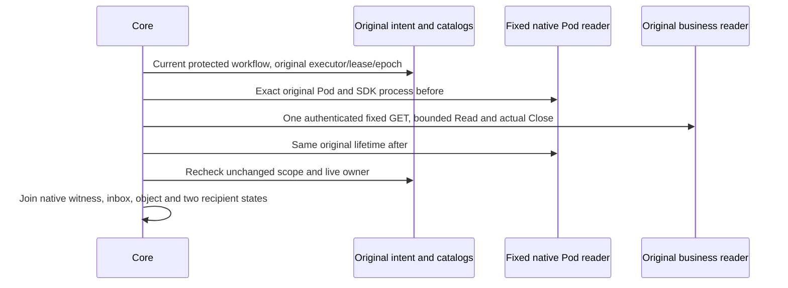

# ADR-0043: Observe original business creation canaries through fixed readers

- **Status:** Proposed
- **Date:** 2026-10-10
- **Deciders:** Giomaster
- **Scope:** yggdrasil-core / protected capacity observations
- **Supersedes:** —
- **Superseded by:** —

## Context

VM creation, Node membership and reserved Pod envelopes do not establish useful
business work. An operator can bind a diagnostic to one original creation, but
a caller-supplied success flag, payload hash or consumer identity cannot supply
that evidence. A competing queue consumer may complete on an old Pod.

Private native HTTP also needs bounds and the actual original Read/Close result.
Cancellation and lease expiry cannot substitute for that return. Existing
ordinary adapter transport remains compatible when the private policy is absent.

## Decision

Observe one original two-recipient creation with an optional, default-off policy
binding and `capacity.observe_original_creation_canary`. The workflow input
selects only policy and binding names. The operator fixes the source build,
query/body/message/recipient hashes, native database/table identities, original
Pod lifetime, verified HTTPS origin and a separate `secret://` read credential.

The backend captures actual input bytes and the actual consumer Pod/process in
the original business transaction. It retains message/body/recipient-set hashes
and count, without duplicating raw message IDs, user IDs or notification copy.
Original state DELETE and notification UPDATE/DELETE remove linkable witness
metadata in that same original transaction, including actor anonymization when
the actor is not a recipient; hashing or default-off alone is not erasure.

The observer resolves neither new provider grants nor capacity commands. It
rechecks both exact active adapter catalogs before private hydration, and the
original intent/generation/fence/executor/lease before and after every source
call. Rotation/revocation of the selected read secret also refuses acceptance.
Original HTTP Do, Read, Close, context causes and deadlines remain retained behind
opaque errors. Native HTTP never follows a redirect or accepts a foreign origin.

## Consequences

| Observation | Meaning |
|---|---|
| `native_creation_canary_observed` | Original input hash, native same-XID business rows and actual selected consumer lifetime joined |
| `preparation_observed` | The owning process's current prepared root frame joined to the independent Pod reader |
| `original_caller_return_known=false` | Native business Commit does not prove the original SDK/callback caller returned |
| `useful_capacity_known=false` | One creation primitive does not certify broader business capacity |
| Competing/changed process, absent witness, changed epoch or late return | HOLD; no send, replay or retarget |

No `CapacityTransitionProof` is produced. Existing phase refusal, HPA command
authority, source catalog checks and original mutation uncertainty are preserved.
Bootstrap, broader warmup, routing, full business drain, original writer
retirement and provider quiescence require their owning native readers.

Production enablement additionally requires immutable source/image provenance,
the approved original-Pod TLS route, separate credential and least-privilege
database access. Source tests and protocol fixtures do not install those things.
The source corpus identifies synthetic Pod projections explicitly; only the
integrated remote native environment can qualify physical Pod/main/AMQP scope.

This source batch registers a protected diagnostic operation, but installs no
elastic policy, Heimdall or workflow consumer that uses the observation in an
authorized capacity decision. Such wiring must retain its limited meaning;
native business creation does not become useful-capacity or transition proof.
The owning Dockerfile and packaging gate compile an exact Git-source pin;
propagating that pin through existing central/manual publishers is separately
required before any operator can opt in through those image paths.

## Related

- ADR-0037 (fixed native observers)
- ADR-0040 (original process lifetime and current admission)
- ADR-0042 (VM/Node join remains diagnostic)
- The owning backend's `CAPACITY_CREATION_CANARY.md` describes capture, fixed
  native SQL, original erasure and its exact qualification limits.
