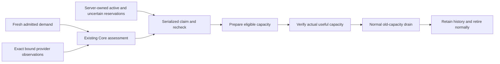

# ADR-0128: Bind adaptive capacity planning to fresh provider observations

- **Status:** Proposed
- **Date:** 2026-11-27
- **Deciders:** Giovanni Martins
- **Scope:** Core / provider-neutral capacity planning and serialized authority
- **Supersedes:** —
- **Superseded by:** —

## Context

An elastic workload must grow with admitted demand and choose economically useful capacity across providers. A fixed nine-node operational configuration and administrative monthly price declarations do not implement that behavior. Provider availability, quotas, billing units, transfer costs and bootstrap times change independently. Rewriting the capacity policy for every quote would also reset existing demand hysteresis because policy content is part of its fingerprint.

Existing protected capacity intents already serialize work, retain uncertain effects, prepare a replacement before retirement and prevent an observation from becoming mutation authority. Preserve that ledger rather than introducing competing allocators for the same pending work.

## Decision

Add an explicit, opt-in runtime market observation contract to the existing capacity policy and assessment path. Only exact policy-bound, read-only integration adapters may supply its observations. Caller-provided prices, quota counters, native readiness and reservation counts are not authoritative. Keep the legacy wire representation and planning behavior unchanged when the new binding is absent.

Derive an effective planning envelope from fresh, comparable all-in cost, independently qualified workload capacity, quota and usage, address and network eligibility, and reservations retained by the server ledger. Preserve the immutable policy identity and its demand clocks. Economic replacement has its own stable candidate, minimum dwell, net-savings and payback requirements. Quote timestamp or price changes must not restart the demand hold window.

A growth plan may exceed the former operational nine-node ceiling when actual eligibility and quotas permit it. There is no promise of infinite supply: provider limits, topology, datastore capacity and machine readiness remain finite constraints. Bound each action and its reservations. Missing or stale information preserves current service and refuses new unsupported authority; it must not be interpreted as zero usage, cheap capacity or an idle workload.

Before claiming execution, collect the configured market observations, serialize shared quota/cost reservation scopes across affected policies, account for all outstanding and uncertain effects, and re-evaluate freshness and the semantic decision under the normal ledger transaction. A price change never authorizes an immediate destructive switch. The destination must pass its actual readiness and useful-capacity checks before the original normal drain and retirement protocol can run.

## Consequences

| Boundary | Required behavior |
|---|---|
| Cost comparison | Same currency and billing horizon; include required disk, address, traffic, warm-up and overlap costs. Unknown required costs remain unknown. |
| Stock | A marketed instance type or availability-zone listing is not a reservation or guarantee of supply. Creation failures may select another eligible provider through a new normal plan. |
| Growth | Effective limits follow actual resource constraints; removing a parser bound alone is not capacity. |
| Stability | Separate demand, emergency availability and economic replacement decisions; no quote-driven oscillation. |
| Uncertainty | No automatic replay of an effect whose outcome is unknown; retain reservation and ownership until proper reconciliation. |
| Adoption | Source and CI success do not prove live switching. Collectors, execution, networking and operational receiving remain required. |
| Qualification | No local tests and no load testing on Hetzner. Any paid remote test requires a complete bounded estimate before resource creation. |

The former administrative-cost mode remains a declaration for its original scope. This decision does not relabel it as a live market observation and does not revive retired Notify or native-abort authorities. Guaranteed instantaneous capacity for arbitrary traffic is not an acceptance claim.

## Related

- ADR-0036: redeem provider mutations once under durable capacity authority.
- ADR-0046: persist bounded capacity intents under protected workflows.
- ADR-0067: separate administrative capacity costs from native quotes.
- ADR-0129: observe Native worker pools independently of HPA workloads.
