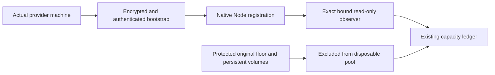

# ADR-0129: Observe Native worker pools independently of HPA workloads

- **Status:** Proposed
- **Date:** 2026-11-27
- **Deciders:** Giovanni Martins
- **Scope:** Core / Native worker pool assessment
- **Supersedes:** —
- **Superseded by:** —

## Context

The current bound HPA observer describes an application workload. Disposable machine capacity has a different lifecycle: a provider may accept a machine before the encrypted bootstrap, private network, Kubernetes registration or useful allocatable resources exist. Treating those events as a successful HPA observation would manufacture capacity. The original Guest Notify protocol is also a separate, immutable authority scope.

## Decision

Use a distinct opt-in Native worker pool binding and typed read-only `observe_native_worker_pool` capability. Bind the exact adapter identity and source contract, cluster realm, pool identity and epoch, provider identity namespace, permitted workload placement and protected floor exclusions. Observations must join actual Kubernetes Node identity, provider identity, readiness, registration and useful allocatable resources. Bootstrap service activity alone is not Node readiness or admitted useful capacity.

Feed this observation through the existing protected assessment and intent ledger. It must not bypass original registration, ownership, unknown-intent, admission, drain or retirement checks. A multi-provider pool has one authoritative owner; the transition must not leave two independent allocators provisioning machines for the same pending work.

## Consequences

The existing HPA and original Guest Notify contracts remain unchanged when the new binding is absent. A renderer, a provider ACK, a running bootstrap unit or a synthetic Node fixture cannot qualify real production worker capacity. The provider integration and actual Native receiving must implement this protocol before execution is enabled. Compute bursting retains its dependency on the original control and data floor; it is not full cross-provider site failover.

A future automatic data-floor switch requires its own replicated destination, single-writer fencing epoch, promotion and traffic-cutover protocol. The current restore-only API and local retained storage protections are not that authority.

## Related

- ADR-0120: separate Core control authority from API worker lifetimes.
- ADR-0128: bind adaptive capacity planning to fresh provider observations.
