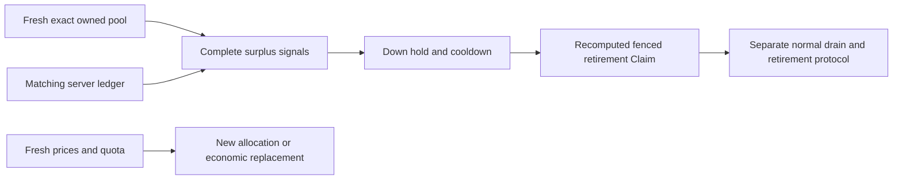

# ADR-0130: Plan owned Native worker retirement without new price authority

- **Status:** Proposed
- **Date:** 2026-11-27
- **Deciders:** Giovanni Martins
- **Scope:** Core / Native worker surplus and reservation planning
- **Supersedes:** —
- **Superseded by:** —

## Context

New allocations require current comparable provider costs and finite quota headroom. Requiring the same offers to release an already owned idle worker makes a pricing outage retain a paid server unnecessarily. Inventing a zero-price offer would erase the difference between an unavailable rate and an independently justified retirement.

## Decision

After the full existing demand, freshness, ownership, semantic pool, down-hold and cooldown checks, classify a reduction of the current Native profile as retirement only. It must strictly reduce its actual admitted worker count without selecting a replacement profile or allocating another VM, disk or address. The complete server ledger must still match the exact current pool, profile, units, epoch and scope. Missing demand, a changed pool or an incomplete ledger holds.

The fresh Claim recomputes this decision under the normal shared reservation transaction. It retains the normal generation, owner, fence and recovery rules and creates no new market allocation reservation. Missing provider costs stay missing; no zero-cost quote is generated or recorded. Pressure growth and economic replacement continue to require the complete fresh market envelope. Legacy modes retain their original behavior.

## Consequences

Retirement only means no new resource allocation. It does not claim that elapsed VM time, commitments, traffic or shutdown are free. Existing work completion, disruption budgets, original Node/provider identity, private-network cleanup and independent native absence proofs remain required before a real retirement. This planning change does not implement or enable the Native worker mutation/admission executor.

CI exercises a complete pricing outage, an expired market, unknown financial reservations and all independent holds. An isolated PostgreSQL fixture explicitly declares a historical confirmed creation and an observer result to qualify the database join and fresh Claim; it does not qualify real provisioning, admission or useful capacity. Tests run only in GitHub Actions, without load or server provisioning on Hetzner.

## Related

- ADR-0128: fresh provider observations and shared reservations.
- ADR-0129: independent Native pool ownership and observation.
