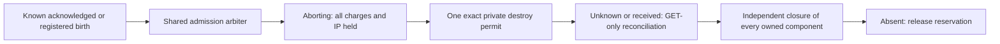

# ADR-0134: Fence pre-admission worker cleanup separately from admission

- **Status:** Proposed
- **Date:** 2026-11-27
- **Deciders:** Giomaster
- **Scope:** Core / default-off Native worker failure recovery
- **Supersedes:** None
- **Superseded by:** None

## Context

A provider can accept a new stateless worker whose bootstrap or admission then
fails. The normal lifecycle reaches retirement through admission and draining.
Inventing either event to clean a failed birth would corrupt authority and
history. An uncertain creation or deletion can also remain billable after the
original request deadline.

## Decision

Add a separate opt-in pre-admission cleanup authority on the existing immutable
Attempt. Serialize it with admission through the existing mutation lock and
Attempt row, then retain an explicit `aborting` state. A private cleanup permit
authorizes at most one exact provider destroy send. Source-selected recovery
workflow, actor/catalog/source/scope and independently current ownership are
required. Future-growth quotes and warmup are not deletion authority.

Disabling policy growth through `execution_enabled` neither grants cleanup nor
silently enables this opt-in. Cleanup requires its own binding, enabled Native
cleanup store, active recovery workflow and current scoped ownership. The
process capacity execution gate remains a global kill switch for redemption.

Only complete no-Node evidence or an exact empty, cordoned and quarantined Node
can qualify the destructive send. Unknown or ambiguous Node inventory does not
mean zero workers. Any possibly successful admission mutation blocks this
branch, especially an exposed `release_quarantine` right. Only a never-redeemed
permit can be closed as server-proven no-effect.

Commit original private return custody before interpretation. Expiry never
reopens a redeemed right, and a late original cannot downgrade independently
observed truth. Provider, Node, registry, network/IPAM and ancillary billable
resources must all have independently qualified closure before `absent`.
Stopped, timeout, HTTP403, HTTP200-empty or a guessed absence never suffices.

## Consequences

This first Source slice supplies the state/arbiter/private permit protocol and
CI-only tests, with no HTTP route, provider destroy implementation, Node cordon
or deletion writer, registry retirement writer or network cleanup writer.
Those independently qualified components remain required before activation.
Creation-ACK-unknown discovery is also not delivered here; its original
uncertainty and charge remain. The slice accepts only an already sealed birth.

Migration115 preserves historical113/114 and their immutable birth/return
custody. Active or uncertain cleanup records prevent rollback. Existing
accounting retains every child and overlay reservation until the final absent
state. No floor, retained data, legacy authority or provider resource is changed
by this Source delivery.

## Related

- ADR-0131: parent reservations, immutable child attempts and physical births.
- ADR-0132: private original-command authority and custody-first callbacks.
- [Native worker lifecycle](../features/native-worker-lifecycle.md).
