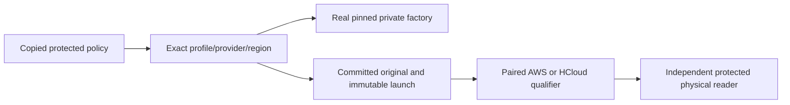

# ADR-0142: Pair concrete Native runtime with typed HCloud qualification

- **Status:** Proposed
- **Date:** 2026-11-27
- **Scope:** Core / protected Native runtime composition

## Context

The concrete runtime initially admitted only AWS factory profiles. The paired
HCloud qualifier now retains an original201/action and independent project/network
observation, including truthful empty account and optional actual HTTP request IDs.
Opening composition by a provider alias or an unproved physical tuple would bypass
that separate boundary.

## Decision

Admit only the exact provider literals `aws` and `hetzner` in the copied policy.
Require every Attempt's profile, provider and market region to match that frozen
table before factory, physical or phase work. Generic fixture providers and aliases
cannot choose either real provider path.

Reuse the existing per-profile private factory and paired ACK qualifier. HCloud
construction requires the separately protected project/anchor scope. Pure factory
preparation precedes CREATE and creates no physical witness. Its market location
remains distinct from the System network region; the System account remains empty.

Qualification still joins exact committed original bytes/private digest and the
current Attempt to its immutable stored launch before an independent provider
read. Only the typed HCloud acceptance/read witness permits its empty account and
absent HTTP request IDs. Sealed reobservation returns only the same physical tuple;
it writes no birth, state, scheduling or admission authority.

## Consequences

The existing ownership transfer, shared Close fence, Source/scope pins and all
three worker/bootstrap/phase ports remain unchanged. Missing independent network
or warmup evidence still blocks admission and quarantine release. No controller,
network writer, guest witness delivery or runtime activation is installed.

CI qualifies exact provider/profile refusals, real PostgreSQL original/witness
custody and pure HCloud preparation with the immutable published System factory
handle. Existing factory roots, race/no-skip verdict and finite watchdog remain.
Source tests make no provider, production, throughput or cost-saving claim.

## Related

- ADR-0139: protected concrete runtime ownership and original ports
- ADR-0141: typed HCloud original acknowledgement and independent witness
