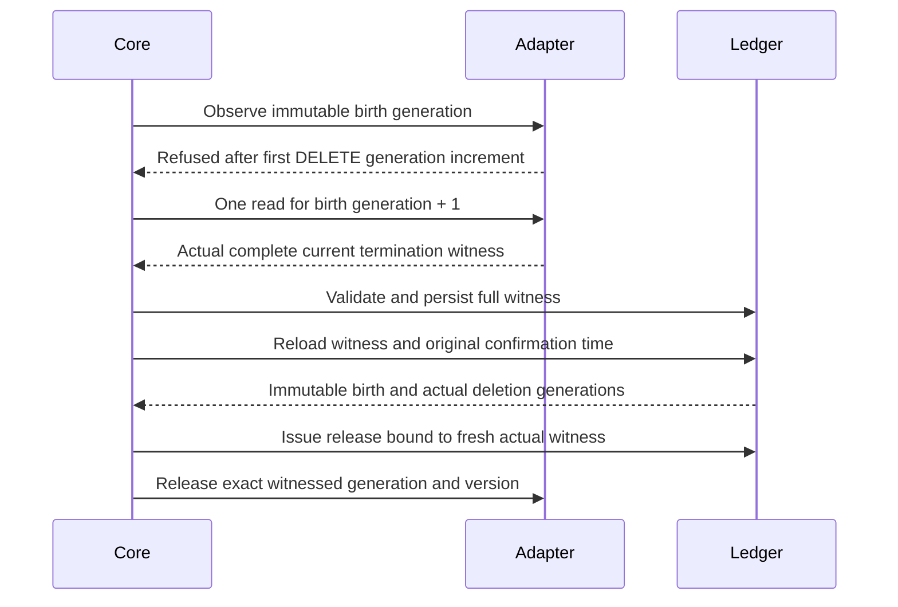

# Native Pod generation during controller retirement

The native lifetime checkpoint retains the Pod generation observed at process
birth. Live inventory, protection and business-root admission require that exact
generation. Core does not update the birth generation when the controller deletes
the Pod.

Kubernetes increments a nonzero `metadata.generation` once when it first sets
`deletionTimestamp`, including for a successfully stopped Pod retained by a
finalizer. This is implemented by
[`BeforeDelete`](https://github.com/kubernetes/apiserver/blob/v0.32.2/pkg/registry/rest/delete.go)
and the generic registry's non-graceful deletion path. A generation of zero is not
incremented; an already pending deletion does not increment it again.

If the adapter refuses an observation against the birth generation, the lifetime
executor may make one additional read against birth generation plus one. That
read qualifies only a complete successful current termination witness, or an
exact post-release observation backed by the already persisted witness. A running
process, unknown receipt, missing deletion timestamp, generation zero to one,
second increment, restart or different process still refuses the transition.
The adapter's exact-generation contract and the native observations stay intact.

After confirming the complete receipt, Core reloads its durable checkpoint and
confirmation timestamp. Release authority uses the actual generation and resource
version in that persisted receipt. The repository independently validates the
same fresh witness before issuing permission. A CAS recovery joins a complete
current inventory row to that separate full witness; inventory cannot certify
termination itself. An unprotected readback must match the witnessed generation
and exact stopped process, even if another finalizer retains the Pod.

Compaction and archived reads revalidate the full receipt, release request and
removal observation against the original policy and their original timestamps.
They preserve both birth and deletion generations without restoring authority.
The PostgreSQL 16/17 CI qualification adds a separate exact case census covering
the transition, refusals, original return acknowledgements, recovery and archive.
It leaves the existing full capacity qualification unchanged. Native API and
operational cycle evidence remain separate from this PostgreSQL proof.
