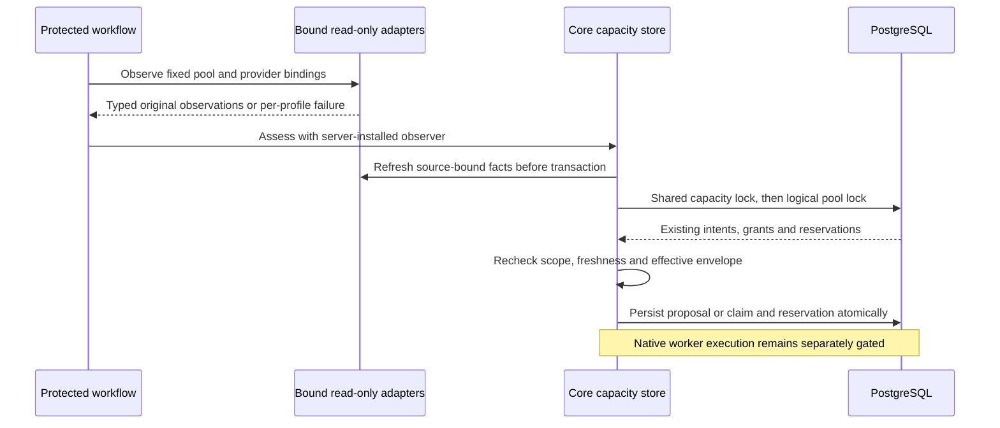

# Protected provider market assessments

The optional `market_binding` and `native_worker_pool_binding` extend the existing capacity planner and PostgreSQL intent ledger. They preserve the legacy wire representation, pricing declarations, demand holds and floor rules when absent. This source stage provides protected read collection, planning and serialized claims; it does **not** enable a Native worker mutation/admission executor or activate a production provider switch.

## Stable policy and fresh facts

| Input | Source and meaning |
|---|---|
| Market profile | Operator-owned provider/region, exact adapter instance version/UUID/checksum and type UUID/checksum, physical specification, workload shape, architecture, registration/network binding and quota dimensions. |
| Cost horizon | One explicit horizon and currency shared by candidate comparisons; rates are not rewritten into the policy. |
| `growth_mode=policy_bounds` | Retain configured profile and policy limits. |
| `growth_mode=observed_constraints` | Require explicit stable zero policy ceiling/profile maximum sentinels. Derive finite effective maxima from fresh quota, address/network and registration eligibility, retained reservations and bounded launch attempts. Zero does not implicitly mean unlimited. |
| `budget_mode=bounded_total` | Require a positive cost bound and exact shared `budget_scope`. |
| `budget_mode=demand_only_no_total_cap` | Require explicit zero budget under this mode; physical and safe admission limits still apply. Do not substitute a maximum integer for infinity. |
| Quote and quota | Exact source-bound read-only `observe_compute_offer`; caller JSON cannot authorize costs or available capacity. |
| Pool | Exact source-bound read-only `observe_native_worker_pool`, independent from HPA and original Guest Notify protocols. |

Both Assess and Claim refresh through the server-installed observer. Before a claim the current catalog revision, semantic pool identity, quote freshness, decision and shared reservations are rechecked. Every Core capacity writer takes the shared reservation lock before its logical scope lock; an overlapping legacy allocator cannot insert a possible-start grant during the market reservation snapshot. An external direct autoscaler is **not** serialized by this database lock: its actual single-owner handoff remains required before adoption.

## Cost and availability decisions

Costs use integer currency micros and overflow-safe arithmetic. Each provider quote declares its own factual currency, which must match the policy and shared assessment; neither the outer policy nor the collector may relabel a USD rate as EUR. No implicit foreign-exchange conversion is supported. Every quote explicitly covers compute, disk/storage, public addresses, load balancer, NAT, traffic, backups, control plane, overlap, migration, warm-up, teardown, remaining commitments and tax. A category is known, affirmatively not applicable, or unknown. An unknown upper charge never becomes zero.

Each known component states its real minimum, billing quantum, rational rate, applicable remaining cycle cap, evidence source and expiry. Provider rates and approved conservative projections are distinct. Economic replacement compares the destination's upper cost with the incumbent's independently justified lower cost over the same units/horizon. It requires absolute and relative savings, its own continuous dwell, minimum residence and cooldown. Fresh quote timestamps do not reset demand holds; missing data or pressure interrupts economic dwell.

All compared candidates must represent the same independently qualified workload unit and architecture. Nominal CPU counts alone are not proof of equal throughput. A provider's offered instance type is explicitly `offered_unreserved`: it authorizes only bounded attempts after the other checks, not a guarantee of stock. A real reserved state requires its own bound reservation reference.

A failed provider read is a typed server collector outcome. It excludes that candidate without fabricating a vendor quote, while an independently healthy provider can still be assessed. If none is eligible, the result holds. Possible starts and uncertain originals keep their quota reservations; an elapsed lease does not free them.

Shared quota dimensions include the exact provider, region, account/project scope and consumption unit. Source-owned legacy allocator maps account for known intersections without reactivating old authorities. An unknown potentially overlapping scope excludes the affected offer, not unrelated providers. Financial reservations are compared only within the same explicit budget scope and compatible horizon/currency.

## Native pool facts

Disposable workers have a legitimate floor of zero; the protected persistent floor is excluded and is never counted as a fictional worker. The pool installation identity is an exact Lease registry UID and expected epoch. Node identity, provider ID, physical and registration bindings, original birth generation/fence and provider creation-proof hash must join immutable server records. Scheduling admission has its own persisted receipt and actual quarantine/taint checks.

Actual collection/Lease resource versions remain native evidence. Stable semantic membership, birth/admission and allocatable state determine native hold/claim compatibility; a routine heartbeat cannot by itself masquerade as a workload replacement. A bootstrap service, provider ACK or kubelet Ready condition alone is not useful admitted capacity.

This first stage deliberately refuses mixed or unready registered pools until the subsequent overlap/replacement executor accounts separately for useful units, still-billed failed physical units and in-flight capacity. Do not remove that check without implementing the corresponding ledger/cost behavior. Routine no-new-spend retirement during a pricing outage, full provider lifecycle execution, the registry writer and full data-floor migration are also separate required implementation work.

## Qualification boundary

Tests run only in GitHub Actions. The source includes deterministic policy/decoder/cost tests and real PostgreSQL reservation/Claim concurrency cases. Static local formatting is not a test pass. No load tests run on Hetzner. Before any paid isolated test elsewhere, verify billing units and a bounded estimate covering setup, runtime, storage, addresses, traffic, overlap and cleanup exposure.

Read-only source integration, CI success and rendered plans are reported separately from installed adapters, actual private-network connectivity, accepted useful workers, complete drain/retirement and production switching. This contract makes no arbitrary-traffic or infinite-capacity deadline promise.

See [ADR-0128](../adr/0128-bind-adaptive-capacity-to-fresh-provider-observations.md) and [ADR-0129](../adr/0129-observe-native-worker-pools-independently-of-hpa.md).
