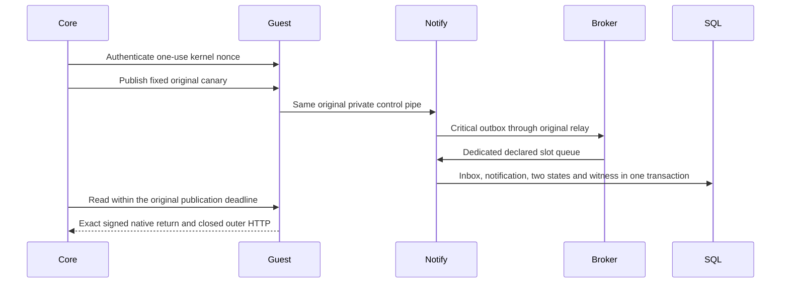

# Core interface and dependency contract

This document describes the source architecture of the public self-hosted Core. It is a parameterized deployment contract: its graph includes explicit dynamic endpoint families, without converting a discovered endpoint or a syntactically valid manifest into production authority. An instantiated deployment must separately bind its Core/Guest artifacts, active manifests, policies, identities, database, broker and native resource observations. Source review does not prove those live bindings.

The checked source census under `source/` records file paths, line locations, function/selector expressions and build constraints. `sources.json` hashes every non-test Go source in the runtime/library/command tree, including the compiled validators under `docs/contracts`. The production image also ships `scripts/goose`, `scripts/bootstrap` and `scripts/bootstrap-admin`; these three command directories are explicitly included. Other development/CI scripts, vendored dependencies and scratch documents are excluded. Dependency implementations are pinned by `go.mod` and `go.sum`. Route registration records include subrouter mounts as mounts; the provider library owns the methods below its mount. A registration count is not a count of production-enabled endpoints.

## HTTP ingress and authorization

`http-routes.json` records actual `Handle` and `HandleFunc` declarations, including handler wrappers and expressions for dynamic mount prefixes. `http-intercept-dispatch.json` additionally records branch predicates in the dedicated capacity/Guest/host dispatchers. These branches intercept requests before the ordinary mux; they must not be omitted merely because they do not call `HandleFunc`.

The `httpapi.New` pipeline is logging, request cache, `requireAuthenticatedConsoleAPIs`, CSRF and the mux. The authentication owner first claims original host-factory credentials/routes, then Guest credentials/routes, original canary claims and capacity mutation credentials/routes; directory machine claims are next. Recognized expired/revoked or malformed dedicated credentials remain in their own rejecting branches; they cannot use a browser cookie or a workflow token to acquire another authority.

The ordinary gate uses `requiresAuthenticatedConsoleRequest`, its exact administration mutation map and `requiresAuthenticatedConsoleAPI` prefix map. It authorizes event writers only on the exact event publication/authorization routes; auth-admin credentials on their administration mutations; deploy credentials on deploy/bootstrap/install routes; and workflow credentials on dispatch/poll routes. It can then resolve an opt-in same-issuer/audience JWT or an opaque session, including the source's phone/MFA/password checks. The route-level `requireOpsPermissionFunc`/`guard` wrappers and handler-owned authorization remain additive. The source records describe current behavior; an unwrapped route is not a declaration that it is anonymous, since some routes authenticate in-handler.

Public health/root/metadata and login/recovery/setup surfaces retain their own documented authentication semantics. Setup/reset tokens are credentials for their exact flows. GitHub/integration webhooks validate their provider-specific authentication in-handler. The ForwardAuth route validates its own session or surface-audience JWT rather than inheriting console audiences. SCIM's subtree uses its independent database-backed bearer authentication and read-only guard. OIDC is mounted only with an issuer and database signing key; its library owns protocol endpoints beneath the mount. The optional console SPA mount is a browser document surface, not API authorization.

Guest principals bind role, member/binding name, slot and profile digest. Their provisioning/retirement handlers validate the current source-owned lifecycle, installation/probe authority and TLS requirements of each phase. Mutation callbacks bind adapter principal, integration, capability and original grant/settlement. Original host requests bind the exact root/owner/scope/stage/roles and dedicated headers, with TLS and canonical paths. The detailed method/path predicates, strict DTO decoders and current repositories remain authoritative; this document cannot mint any authority those owners refuse.

The production `original-profile-authority-v2` member/slot GET adds canonical
boot ID and request nonce digest headers to that existing private provisioning
scope, with no profile selector, query, body or caller duration. The same current
PG transaction signs the immutable preregistration, witness, profile and remaining
original interval. The Guest conservatively transfers it to its original
CLOCK_BOOTTIME acquisition and complete five-second exchange. Explicit result,
enrollment-clock digest and installation V2 preserve separate Core PG and Guest
chronology. Installation revalidates immutable registration bytes, the distinct
nested result digest and the exact receipt/enrollment; this route introduces no
new endpoint destination, credential grant, database schema or production
registry approval. Qualification V1 retains its own unchanged contract.

The production Guest Notify canary uses distinct signed nonce, publication and read routes over the same enrolled actor/runtime/application. One original Core five-second context covers publication and read. The read must share the publication's immutable executor, policy, epoch, enrollment and resource tuple, and cannot outlive its original deadline. Core persists nonce finalization and possible-send custody before the sole publication POST. A closed HTTP return and native SQL Rows.Close remain separate from the persistent application pipe's final retirement EOF/Close.

The Guest-v2 native read emits all five commit fields explicitly. With PostgreSQL commit tracking disabled they are NULL; with tracking enabled they must contain equal native commit timestamps. Freshness comes from the unique current publication, actual original SDK Commit, subsequent original consumer transaction visibility and read within that same five-second context, plus subsequent age on Core PostgreSQL. A native observation time never refreshes an old creation. Legacy application canaries retain their own contract. Useful membership and promotion reconstruct the original raw evidence; retirement checks a surviving useful floor before withdrawal and requires another original floor proof issued after the durable caller acknowledgement before deletion.

The separate stable-epoch maintenance operation can refresh only these fixed canaries. Every challenge/nonce/send/return rechecks the current policy and stable epoch under the dimension lock. It cannot acquire or renew a VM lease, adopt an unresolved provider grant or declare an old writer quiescent. The compiled production approval registry remains the source-owned boundary.

## Events and RPC

Core mutation events are persisted by `repository.EmitEventWithOutcome` in the caller's SQL transaction. The state change, event and materialized reactions commit or roll back together. The event log is audit/notification state; it does not replace current resource or lifecycle authority. Idempotency uses event type plus idempotency key where supplied. Reactive workflow dispatch, reactor reconciliation and event-stream consumers read committed records using their existing checkpoints and deduplication semantics.

`event-emissions.json` lists actual repository/helper emission callsites and their type expressions. Dynamic expressions are retained as expressions, rather than pretending every event type is a source literal. `event-and-queue-constants.json` lists source constants, and `event-schemas.json` lists embedded schema keys, not an assertion that a schema filename is a wire event name. The closed canonical mapping and dynamic provider/resource mutation grammar live in `docs/contracts/events_validator.go`; consumers must continue to use that validator. External mutation writers use exact or logical grants on the event HTTP surface; human sessions and workflow credentials do not inherit publication permission. The explicit credential-free development posture is not a production fallback.

The `native-qemu.server.ensured` and `.destroyed` schemas are embedded by `events_native_qualification_enabled.go` only when the `nativequalification` build tag is selected. Default builds use the separate default mapping and do not acquire those events merely because schema files exist in the repository. The native qualification echo and source-only provider realm do not represent a production workload roster.

`rpc-consumers.json` enumerates `ConsumerConfig.Queue` selections. `RegisterAllConsumers` composes manifest, identity, integration, topology, product, workflow and event-stream groups and passes each endpoint, handler, timeout and concurrency to the configured `rpc.Transport`. The shipped addon creates an AMQP transport from the configured broker. Endpoint names are logical RPC destinations; they are not necessarily REST URLs. Handler-level manifest/RBAC/scope checks still govern requests.

## Outbound destinations and trust boundaries

`http-egress.json` records HTTP request constructors and transport callsites. It deliberately retains dynamic argument expressions. The following families complete the logical graph:

- Adapter calls resolve active integration instance/type manifests, credentials references and transport definitions. AMQP endpoint names or HTTP base URLs/capability routes come from that active configuration. Ordinary HTTP transport supports the source's `http`/`https` rules; this contract does not falsely claim every ordinary adapter call already uses the protected Guest TLS policy. Protected native/Guest calls use their separate private policies, exact origins, credentials and original deadlines.
- Quickstart installation fetches an operator-selected catalog URL through its existing validation path. A fetched document is not automatically installed or trusted beyond its owning manifest/install checks.
- Surface discovery, manifest/data reads and declared actions use configured/discovered surface base URLs and view/action metadata. Permission and handler checks remain in the caller; a surface URL is not a global egress grant.
- OAuth/OIDC third-party login uses configured provider discovery, token and userinfo URLs. Back-channel logout uses registered relying-party URIs and the existing signed token/client rules. Same-process OP JWT verification reads its own signing key set; it is not an arbitrary remote JWKS fetch.
- Original host/Guest/capacity callers use the exact Core/member origin, mTLS/bearer/phase bindings and closed response checks in their owners. The source-only native qualification and fixture callers are distinguished by build constraints in the census and are not a production egress list.
- The operator and public CLI clients call the user-configured Core origin. They are separate command entry points, not additional listeners inside the Core daemon.
- The optional direct AWS provisioner uses the SDK default credential chain and configured region for S3 bucket/CORS, SES identity and SNS topic operations. `provider-sdk-operations.json` names the four source SDK callsites. This is separate from the general adapter transport graph; absence of a literal `http.NewRequest` does not remove SDK network effects. Dispatch lock disables construction of this optional client.

The actual destinations, DNS/network policy, principal grants and provider permissions must be resolved from the active deployment. No new destinations, credentials, security groups or routes are approved by adding this contract. Secret values are excluded; names and references belong to the owning configuration/secret resolver.

## Shipped command ingress and database operations

`production-command-operations.json` records the actual selected database, transaction, manifest and migration callsites in the three commands shipped by the Dockerfile. Their argv and local manifest files are command ingress, separate from daemon HTTP authentication. They use the existing PostgreSQL configuration and credentials; this source contract grants no operator or database privilege.

- `goose` accepts `up`, `down`, `status` or `new`. The first three load the PostgreSQL DSN, open and ping the database, then call Goose against `db/migrations`; `down` can change existing data/schema. `new` writes a sanitized migration filename locally instead of opening the database. Migration checksums and rollout/restore rules remain release obligations.
- `bootstrap` discovers JSON files under its selected manifest path, normalizes and validates every document before opening PostgreSQL. `--dry-run` exits after validation. Otherwise each import uses its own context deadline, resolves the manifest including deleted versions, skips an identical checksum and creates a new manifest version for an absent or changed document. It is a manifest importer, not a new unauthenticated HTTP endpoint.
- `bootstrap-admin` requires an email for an existing collaborator who has already logged in. It looks that collaborator up, starts a database transaction, adds membership to the selected team (default `yggdrasil-admin`) through `AddCollaboratorToTeamBySlugTx` with actor `bootstrap-cli`, and commits with deferred rollback. It does not create a collaborator. Database credentials and the authority to execute the command are the deployment's administrative boundary.

## Runtime/data topology

`main` applies registered addons to one runtime service. PostgreSQL is opened/pinged by its addon and is required by HTTP startup. It owns manifests, identities, grants, leases, workflow state and the event log. Goose migrations and their checksums belong to the immutable release; backup/restore consistency must include state and events together. Core database major and restore compatibility must be observed for the actual Core database, not inferred from a business application RDS instance.

The broker addon uses `BROKER_URL`. With no broker or a non-locking connection failure, Core can run its documented degraded authentication/read/wake posture; a workflow dispatch lock additionally requires broker queue verification. A healthy HTTP process is therefore insufficient evidence of usable workflow capacity. Optional reconcilers, discovery/reactor/scheduler work are enabled only through the runtime resources/configuration they require.

The Kubernetes files under `platform/` contain scaffold placeholders and are not an instantiated production topology. Dockerfile/entrypoint and actual deployment manifests determine binaries, mounts, migrations and graceful shutdown. Production rollout needs immutable artifacts, compatible prior artifacts/schema, target identity and current observation. Readiness, canary utility, admission/drain/fencing/retirement and data restoration retain their independent gates.

The HTTP addon optionally binds a secondary TLS socket through the same original handler and process-local authority registry. With `HTTP_TLS_SECONDARY_ADDR`, primary HTTP remains available; the certificate/key pair is loaded once before HTTP database/OIDC bootstrap and requires a distinct canonical literal address/port. Both sockets bind before either serves; failure closes already bound sockets. Shutdown uses the same caller context without a renewed deadline. Direct TLS alone does not establish a production route, certificate identity, workload readiness or private authority origin; those remain deployment obligations (ADR-0062).

An optional closed `slot_bootstraps` profile list binds each member to its own user-data hash. Its mode excludes the legacy shared hash, and the policy slot, original create witness and bootstrap journal must agree on the selected native slot. The common setup executable keeps its independent payload hash. Provider adapters select only that slot's protected template before grant/send; another slot's private keys or configuration are never a fallback. An omitted list preserves the legacy signed wire.

Production retirement V2 uses the same exact actor credential family at fixed
`GET /internal/capacity/guest-retirement/v2/authority`. Its closed request pins the
full final intent hash, phase and canonical request UUID before a durable read
ordinal is consumed. Core connects only to the enrolled fixed Guest mTLS origin
and V2 nonce/retire/observation paths. The monotonic Guest nonce and actual Core
caller deadline have separate owners. No later native GET replaces missing
original writer joins or a complete original caller acknowledgement.

V2 native off and original destroy readbacks use exact source-pinned adapter
catalogs: EC2 instance/lifecycle and retained EBS/ENI, or Hetzner server/action and
retained Primary IPs. The dedicated Hetzner 0.3 GET-only retirement reader has a
reviewed literal publication gate; the compiled profile contract remains an
independent default-closed approval. One source finish invocation may poll only
known pending GETs within its sixty-second owner, with each complete read bounded
by five seconds. Only its actual Core PG custody age contributes to freshness;
provider timestamps stay inside original native content. Confirming release also
rechecks the complete original Guest chain, durable original destroy receipt and
fresh useful floor after caller acknowledgement. No source fabricates a drained
metric assessment or self-advances a workflow phase to obtain destroy authority.

## Review and updates

The service descriptor selects `public-go-module-v1` explicitly. An unknown profile fails; descriptors without a selector keep the legacy DaKasa scaffold checks. The public profile verifies the exact module/repository identity, real layout, closed bounded contract, hash-bound graph evidence and full source-file census. It does not require the unrelated private namespace, vendoring or Air scaffold. It must continue to reject a candidate/incomplete review, altered evidence, extra/missing/changed source, indirect evidence and empty graph sections.

The independently reviewed source graph is accepted under the evidence in `REVIEW.json`, including the owning compiled CLI and full integrated census. Setting a status string alone is not an approval mechanism. Any subsequent source change requires an updated census and an independent review of that change. The source-review checklist covers census completeness (including shipped commands), credential dispatch, actual logical edges, bounded closed checker behavior and the compiled owning CLI against these exact files. Instantiated production topology and actual provider/catalog/source qualification are independent deployment obligations; they do not keep a completed source review circularly unresolved, and remain required after source acceptance.
