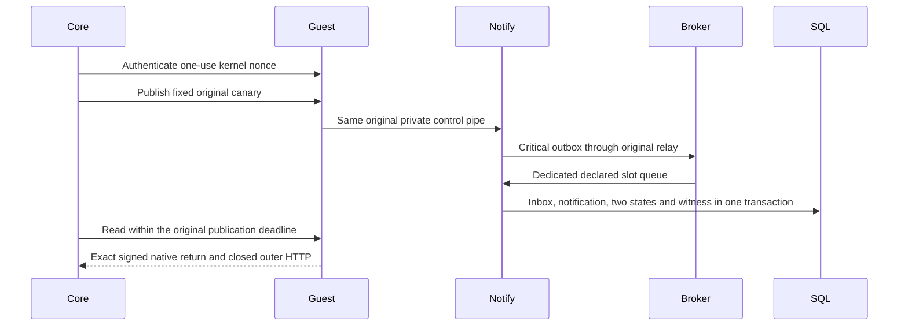

# Core interface and dependency contract

This document describes the source architecture of the public self-hosted Core. It is a parameterized deployment contract: its graph includes explicit dynamic endpoint families, without converting a discovered endpoint or a syntactically valid manifest into production authority. An instantiated deployment must separately bind its Core/Guest artifacts, active manifests, policies, identities, database, broker and native resource observations. Source review does not prove those live bindings.

The checked source census under `source/` records file paths, line locations, function/selector expressions and build constraints. `sources.json` hashes every non-test Go source in the runtime/library/command tree, including the compiled validators under `docs/contracts`. Each source record retains its path, SHA256, byte count and `build_constraint` field: the field contains the exact explicit `//go:build` expression, or an empty string when no such directive exists. Filename suffixes can still impose implicit GOOS/GOARCH constraints; an empty field does not assert inclusion in every build. Other fact envelopes retain the descriptive `default` marker for an absent directive. The production image also ships `scripts/goose`, `scripts/bootstrap` and `scripts/bootstrap-admin`; these three command directories are explicitly included. Other development/CI scripts, vendored dependencies and scratch documents are excluded. Dependency implementations are pinned by `go.mod` and `go.sum`. Route registration records include subrouter mounts as mounts; the provider library owns the methods below its mount. A registration count is not a count of production-enabled endpoints.

The `nativequalification`-only original QEMU fixture exposes fixed Describe and read-only Execute consumers on predeclared qualification queues. It uses a separate connection to the fixed loopback CI broker for those consumers, while the original workflow client keeps its own connection. Startup and shutdown guards close only the dedicated socket on expiry and retain the error; shutdown still waits for the original handlers. The Describe contract and broker tests provide source transport evidence, not native qualification or production authority. The fixture neither declares production queues nor contacts a production broker.

## HTTP ingress and authorization

`http-routes.json` records actual `Handle` and `HandleFunc` declarations, including handler wrappers and expressions for dynamic mount prefixes. `http-intercept-dispatch.json` additionally records branch predicates in the dedicated capacity/Guest/host dispatchers. These branches intercept requests before the ordinary mux; they must not be omitted merely because they do not call `HandleFunc`.

The `httpapi.New` pipeline is logging, request cache, `requireAuthenticatedConsoleAPIs`, CSRF and the mux. The authentication owner decides directory machine claims first, followed by original host-factory credentials/routes, Guest credentials/routes, original canary claims and capacity mutation credentials/routes. Ambiguous Directory claims and Directory requests that also claim a host, Guest, canary or capacity identity are rejected with synchronous audit. Recognized expired/revoked or malformed dedicated credentials remain in their own rejecting branches; they cannot use a browser cookie or a workflow token to acquire another authority.

The ordinary gate uses `requiresAuthenticatedConsoleRequest`, its exact administration mutation map and `requiresAuthenticatedConsoleAPI` prefix map. It authorizes event writers only on the exact event publication/authorization routes; auth-admin credentials on their administration mutations; deploy credentials on deploy/bootstrap/install routes; and workflow credentials on dispatch/poll routes. It can then resolve an opt-in same-issuer/audience JWT or an opaque session, including the source's phone/MFA/password checks. The route-level `requireOpsPermissionFunc`/`guard` wrappers and handler-owned authorization remain additive. The source records describe current behavior; an unwrapped route is not a declaration that it is anonymous, since some routes authenticate in-handler.

Public health/root/metadata and login/recovery/setup surfaces retain their own documented authentication semantics. Setup/reset tokens are credentials for their exact flows. GitHub/integration webhooks validate their provider-specific authentication in-handler. The ForwardAuth route validates its own session or surface-audience JWT rather than inheriting console audiences. SCIM's subtree uses its independent database-backed bearer authentication and read-only guard. OIDC is mounted only with an issuer and database signing key; its library owns protocol endpoints beneath the mount. The optional console SPA mount is a browser document surface, not API authorization.

Guest principals bind role, member/binding name, slot and profile digest. Their provisioning/retirement handlers validate the current source-owned lifecycle, installation/probe authority and TLS requirements of each phase. Mutation callbacks bind adapter principal, integration, capability and original grant/settlement. Original host requests bind the exact root/owner/scope/stage/roles and dedicated headers, with TLS and canonical paths. The detailed method/path predicates, strict DTO decoders and current repositories remain authoritative; this document cannot mint any authority those owners refuse.

The production `original-profile-authority-v2` member/slot GET adds canonical
boot ID and request nonce digest headers to that existing private provisioning
scope, with no profile selector, query, body or caller duration. The same current
PG transaction signs the immutable preregistration, witness, profile and remaining
original interval. The Guest conservatively transfers it to its original
CLOCK_BOOTTIME acquisition and complete five-second exchange. Explicit result,
enrollment-clock digest and installation V2 preserve separate Core PG and Guest
chronology. Installation revalidates immutable registration bytes, the distinct
nested result digest and the exact receipt/enrollment; this route introduces no
new endpoint destination, credential grant, database schema or production
registry approval. Qualification V1 retains its own unchanged contract.

The production Guest Notify canary uses distinct signed nonce, publication and read routes over the same enrolled actor/runtime/application. One original Core five-second context covers publication and read. The read must share the publication's immutable executor, policy, epoch, enrollment and resource tuple, and cannot outlive its original deadline. Core persists nonce finalization and possible-send custody before the sole publication POST. A closed HTTP return and native SQL Rows.Close remain separate from the persistent application pipe's final retirement EOF/Close.

The Guest-v2 native read emits all five commit fields explicitly. With PostgreSQL commit tracking disabled they are NULL; with tracking enabled they must contain equal native commit timestamps. Freshness comes from the unique current publication, actual original SDK Commit, subsequent original consumer transaction visibility and read within that same five-second context, plus subsequent age on Core PostgreSQL. A native observation time never refreshes an old creation. Legacy application canaries retain their own contract. Useful membership and promotion reconstruct the original raw evidence; retirement checks a surviving useful floor before withdrawal and requires another original floor proof issued after the durable caller acknowledgement before deletion.

The separate stable-epoch maintenance operation can refresh only these fixed canaries. Every challenge/nonce/send/return rechecks the current policy and stable epoch under the dimension lock. An installed member preregistered under an older version of the same capacity_policy is admitted only when that version and every later stored one carry the byte-identical Guest production contract (ADR-0094); a newer version, another policy or a changed contract is refused. It cannot acquire or renew a VM lease, adopt an unresolved provider grant or declare an old writer quiescent. The compiled production approval registry remains the source-owned boundary. Its challenge lease owner is the deterministic UUIDv5 of the executor under a fixed maintenance name-space, because the Guest admits only a 36-byte UUID owner; Core refuses any non-UUID owner before committing the challenge. The hourly publication maximum counts only publications with a possible-send row or still inside their original window; refused attempts back off exponentially from the minimum interval to a 15-minute gap, and every attempt stays under a fixed 120 per hour. A nonce refusal keeps only the Guest HTTP status and a closed problem code (ADR-0093).

## Events and RPC

Core mutation events are persisted by `repository.EmitEventWithOutcome` in the caller's SQL transaction. The state change, event and materialized reactions commit or roll back together. The event log is audit/notification state; it does not replace current resource or lifecycle authority. Idempotency uses event type plus idempotency key where supplied. Reactive workflow dispatch, reactor reconciliation and event-stream consumers read committed records using their existing checkpoints and deduplication semantics.

`event-emissions.json` lists actual repository/helper emission callsites and their type expressions. Dynamic expressions are retained as expressions, rather than pretending every event type is a source literal. `event-and-queue-constants.json` lists source constants, and `event-schemas.json` lists embedded schema keys, not an assertion that a schema filename is a wire event name. The closed canonical mapping and dynamic provider/resource mutation grammar live in `docs/contracts/events_validator.go`; consumers must continue to use that validator. External mutation writers use exact or logical grants on the event HTTP surface; human sessions and workflow credentials do not inherit publication permission. The explicit credential-free development posture is not a production fallback.

The `native-qemu.server.ensured` and `.destroyed` schemas are embedded by `events_native_qualification_enabled.go` only when the `nativequalification` build tag is selected. Default builds use the separate default mapping and do not acquire those events merely because schema files exist in the repository. The native qualification echo and source-only provider realm do not represent a production workload roster.

`rpc-consumers.json` enumerates `ConsumerConfig.Queue` selections. `RegisterAllConsumers` composes manifest, identity, integration, topology, product, workflow and event-stream groups and passes each endpoint, handler, timeout and concurrency to the configured `rpc.Transport`. The shipped addon creates an AMQP transport from the configured broker. Endpoint names are logical RPC destinations; they are not necessarily REST URLs. Handler-level manifest/RBAC/scope checks still govern requests.

## Outbound destinations and trust boundaries

`http-egress.json` records HTTP request constructors and transport callsites. It deliberately retains dynamic argument expressions. The following families complete the logical graph:

- Adapter calls resolve active integration instance/type manifests, credentials references and transport definitions. AMQP endpoint names or HTTP base URLs/capability routes come from that active configuration. Ordinary HTTP transport supports the source's `http`/`https` rules; this contract does not falsely claim every ordinary adapter call already uses the protected Guest TLS policy. Protected native/Guest calls use their separate private policies, exact origins, credentials and original deadlines.
- Quickstart installation fetches an operator-selected catalog URL through its existing validation path. A fetched document is not automatically installed or trusted beyond its owning manifest/install checks.
- Surface discovery, manifest/data reads and declared actions use configured/discovered surface base URLs and view/action metadata. Permission and handler checks remain in the caller; a surface URL is not a global egress grant.
- OAuth/OIDC third-party login uses configured provider discovery, token and userinfo URLs. Back-channel logout uses registered relying-party URIs and the existing signed token/client rules. Same-process OP JWT verification reads its own signing key set; it is not an arbitrary remote JWKS fetch.
- Original host/Guest/capacity callers use the exact Core/member origin, mTLS/bearer/phase bindings and closed response checks in their owners. The source-only native qualification and fixture callers are distinguished by build constraints in the census and are not a production egress list.
- The operator and public CLI clients call the user-configured Core origin. They are separate command entry points, not additional listeners inside the Core daemon.
- The optional direct AWS provisioner uses the SDK default credential chain and configured region for S3 bucket/CORS, SES identity and SNS topic operations. `provider-sdk-operations.json` names the four source SDK callsites. This is separate from the general adapter transport graph; absence of a literal `http.NewRequest` does not remove SDK network effects. Dispatch lock disables construction of this optional client.

The native authorization-denial accounting bridge uses the compiled dedicated HTTP origin `http://integration-aws-native-denied-readonly.dakasa.svc.cluster.local:8081`. It authenticates the complete normal historical/current AWS catalogs and hydrates the historical instance credentials before projecting the historical type into the published AWS protocol DTO. A source-pinned dedicated Describe is required before and after the single observation execute call. The dedicated process registers no normal AWS operations, event emitter or AMQP consumer and reads only the scoped original STS, CloudTrail and EC2 evidence. The historical creator, actual observer source and normal supplier source remain distinct. This source graph declaration supplies no deployed reachability, ledger completion or provider mutation authority.

The actual destinations, DNS/network policy, principal grants and provider permissions must be resolved from the active deployment. No new destinations, credentials, security groups or routes are approved by adding this contract. Secret values are excluded; names and references belong to the owning configuration/secret resolver.

## Shipped command ingress and database operations

`production-command-operations.json` records the actual selected database, transaction, manifest and migration callsites in the three commands shipped by the Dockerfile. Their argv and local manifest files are command ingress, separate from daemon HTTP authentication. They use the existing PostgreSQL configuration and credentials; this source contract grants no operator or database privilege.

- `goose` accepts `up`, `down`, `status` or `new`. The first three load the PostgreSQL DSN, open and ping the database, then call Goose against `db/migrations`; `down` can change existing data/schema. `new` writes a sanitized migration filename locally instead of opening the database. Migration checksums and rollout/restore rules remain release obligations.
- `bootstrap` discovers JSON files under its selected manifest path, normalizes and validates every document before opening PostgreSQL. `--dry-run` exits after validation. Otherwise each import uses its own context deadline, resolves the manifest including deleted versions, skips an identical checksum and creates a new manifest version for an absent or changed document. It is a manifest importer, not a new unauthenticated HTTP endpoint.
- `bootstrap-admin` requires an email for an existing collaborator who has already logged in. It looks that collaborator up, starts a database transaction, adds membership to the selected team (default `yggdrasil-admin`) through `AddCollaboratorToTeamBySlugTx` with actor `bootstrap-cli`, and commits with deferred rollback. It does not create a collaborator. Database credentials and the authority to execute the command are the deployment's administrative boundary.

## Runtime/data topology

`main` applies registered addons to one runtime service. PostgreSQL is opened/pinged by its addon and is required by HTTP startup. It owns manifests, identities, grants, leases, workflow state and the event log. Goose migrations and their checksums belong to the immutable release; backup/restore consistency must include state and events together. Core database major and restore compatibility must be observed for the actual Core database, not inferred from a business application RDS instance.

The broker addon uses `BROKER_URL`. With no broker or a non-locking connection failure, Core can run its documented degraded authentication/read/wake posture; a workflow dispatch lock additionally requires broker queue verification. A healthy HTTP process is therefore insufficient evidence of usable workflow capacity. Optional reconcilers, discovery/reactor/scheduler work are enabled only through the runtime resources/configuration they require.

The Kubernetes files under `platform/` contain scaffold placeholders and are not an instantiated production topology. Dockerfile/entrypoint and actual deployment manifests determine binaries, mounts, migrations and graceful shutdown. Production rollout needs immutable artifacts, compatible prior artifacts/schema, target identity and current observation. Readiness, canary utility, admission/drain/fencing/retirement and data restoration retain their independent gates.

The HTTP addon optionally binds a secondary TLS socket through the same original handler and process-local authority registry. With `HTTP_TLS_SECONDARY_ADDR`, primary HTTP remains available; the certificate/key pair is loaded once before HTTP database/OIDC bootstrap and requires a distinct canonical literal address/port. Both sockets bind before either serves; failure closes already bound sockets. Shutdown uses the same caller context without a renewed deadline. Direct TLS alone does not establish a production route, certificate identity, workload readiness or private authority origin; those remain deployment obligations (ADR-0062).

An optional closed `slot_bootstraps` profile list binds each member to its own user-data hash. Its mode excludes the legacy shared hash, and the policy slot, original create witness and bootstrap journal must agree on the selected native slot. The common setup executable keeps its independent payload hash. Provider adapters select only that slot's protected template before grant/send; another slot's private keys or configuration are never a fallback. An omitted list preserves the legacy signed wire.

Production retirement V2 uses the same exact actor credential family at fixed
`GET /internal/capacity/guest-retirement/v2/authority`. Its closed request pins the
full final intent hash, phase and canonical request UUID before a durable read
ordinal is consumed. Core connects only to the enrolled fixed Guest mTLS origin
and V2 nonce/retire/observation paths. The monotonic Guest nonce and actual Core
caller deadline have separate owners. No later native GET replaces missing
original writer joins or a complete original caller acknowledgement.

V2 native off and original destroy readbacks use exact source-pinned adapter
catalogs: EC2 instance/lifecycle and retained EBS/ENI, or Hetzner server/action and
retained Primary IPs. The dedicated Hetzner 0.3 GET-only retirement reader has a
reviewed literal publication gate; the compiled profile contract remains an
independent default-closed approval. One source finish invocation may poll only
known pending GETs within its sixty-second owner, with each complete read bounded
by five seconds. Only its actual Core PG custody age contributes to freshness;
provider timestamps stay inside original native content. Confirming release also
rechecks the complete original Guest chain, durable original destroy receipt and
fresh useful floor after caller acknowledgement. No source fabricates a drained
metric assessment or self-advances a workflow phase to obtain destroy authority.

## Original Notify Guest scheduler source

The common cron selector honors `catchup_policy`: `skip` (also the default)
coalesces missed occurrences to the latest real tick due at the observed time;
explicit `catch_up` keeps the oldest next tick for a later pass. Both capacity
and legacy dispatch use that same selection. The existing admission transaction
alone advances the cursor; pre-admission refusal or transaction rollback neither
consumes it nor creates acknowledgments for the omitted historical ticks.

An explicit original_guest_notify_reconcile_v1 binding selects the existing
durable scheduler/dispatch owner and a canonical seven-step Guest graph. The
new capacity.plan_original_guest and capacity.complete_original_guest operations
collect fixed native inventory and pinned metric bindings, select one actual
approved slot, and join the existing original provisioning, canary, retirement
and finish operations. No HPA step is translated into VM authority. Current
policy/workflow/principal/RBAC, compiled source approval, epoch, original lease,
full enrollment/witness/installation and raw useful-membership returns remain
independent mandatory checks. Unknown grants or native tuples stay HOLD without
replay/adoption. A source-captured remaining lease clips every later step; the
600-second workflow step does not renew the original provider budget or lease.

Demand is actual handler inflight per complete reporting member. A separate
MemberCoverage range must match the complete current native membership for the
whole quality window; a partial low aggregate cannot authorize retirement. The
source choices use a real complete 300-second Demand range with at least61
samples and a separate complete30-second Coverage range with at least5samples.
Range gaps and scheduled controller intervals have separate bounds. New Guest
thresholds are strictly above/below; historical HPA equality and observation
clocks retain their prior behavior. Missing metrics never become zero. Native
empty inventory can plan protected-floor recovery. Only its original zero-to-one
claim may complete before Demand300 matures, using the exact complete raw
Coverage30 response revalidated at transaction time. Its captured empty baseline,
live original lease, current native/member ledger and raw useful-canary joins
remain mandatory. The assessment retains missing demand unchanged; subsequent
expansion and retirement still require the full demand contract. Native initial
telemetry maturation and complete lifecycle execution require owning
qualification; this source contract does not certify those transitions.

An optional reviewed_administrative_cost_assumption is an explicit finite
planning declaration outside the protected ProfileManifest/approval hash. It
requires the legacy quote/validation dates to be zero, its own reviewed expiry
and exact selected native currency. The selected AWS and Hetzner profiles are
USD; no native price is relabeled or converted. An administrative assumption is
not future price, stock, invoice evidence or an actual charge cap. Hetzner still
requires its original fresh quote before creation. Omission preserves the dated
legacy policy contract. The additive Hetzner0.3.3/0.3.4 supplier gates retain the
exact original source/catalog joins and earlier selected versions, without
adopting a prior instance as a new provider version.

This source revision compiles exactly the two reviewed original Notify profile
contracts for AWS and Hetzner. Each complete contract binds its actual native
adapter instance/type, eight slots, public identities, canary and protected
writer catalog. Runtime current Core source is checked separately to avoid a
self-referential commit hash. Qualification and other profiles remain excluded.
An exact source approval supplies no current policy, lease, useful member,
provider grant, credential, deployment or VM.
The AWS1.64 supplier requires its complete closed catalog, including
`observe_fleet_inventory` in the instance resource's default actions. The
source-pinned inventory reports physical profile membership; Core still joins
the original grant, enrollment and useful-canary ledgers separately. A new
adapter instance changes the complete mutation contract, scope and admission
checksums even when its eight bootstrap bodies stay identical. The corresponding
managed policy must authorize that actual new scope before any mutation.
Other AWS versions retain their explicit catalog gates; an unknown future
version cannot inherit this supplier approval.
Source review, portable tests and a required no-skip owning PostgreSQL refusal
gate do not substitute for genuine positive native authority or production
usefulness.

## Review and updates

The service descriptor selects `public-go-module-v1` explicitly. An unknown profile fails; descriptors without a selector keep the legacy DaKasa scaffold checks. The public profile verifies the exact module/repository identity, real layout, closed bounded contract, hash-bound graph evidence and full source-file census. It does not require the unrelated private namespace, vendoring or Air scaffold. It must continue to reject a candidate/incomplete review, altered evidence, extra/missing/changed source, indirect evidence and empty graph sections.

The independently reviewed source graph is accepted under the evidence in `REVIEW.json`, including the owning compiled CLI and full integrated census. Setting a status string alone is not an approval mechanism. Any subsequent source change requires an updated census and an independent review of that change. The source-review checklist covers census completeness (including shipped commands), credential dispatch, actual logical edges, bounded closed checker behavior and the compiled owning CLI against these exact files. Instantiated production topology and actual provider/catalog/source qualification are independent deployment obligations; they do not keep a completed source review circularly unresolved, and remain required after source acceptance.

## Expired original accepted creation dispositions

The administrative original-create-dispositions POST accepts only a canonical
original grant UUID. Both POST and exact-grant GET require an authenticated human
collaborator with actual `yggdrasil:*` permission, independently of machine and
warn-mode shortcuts. Core obtains the native observation through the active
version of the historical creator's logical integration identity. Its current
observer UUID, checksum and source are validated independently; the old grant,
policy, preregistration, accepted settlement and source are never relabelled.

The read-only adapter capability authenticates exact native terminal absence and
complete required auxiliary absence. The separate AWS CloudTrail/root-snapshot
basis preserves the original unknown inventory and proves only complete absence
of snapshot descendants and the exact original interface. Full native bodies
remain in bounded immutable database evidence, outside the ordinary HTTP
summary. Neither basis supplies a signed Guest witness, business readiness,
writer quiescence, deletion permission or savings authority.

Migration 71 adds an append-only disposition and a one-way, matching-grant
foreign-key pointer. Completion rechecks unchanged originals, PostgreSQL expiry,
zero witness/enrollment/installation, protected zero-member recovery, no active
owning invocation and no serving slots under the same scope and slot locks.
Only that validated pointer removes the original from open-slot reservations;
its accepted state and JSON stay unchanged. A later creation requires a new
assessment, generation, higher fence and separate single-use grant. An uncertain
administrative acknowledgment is reconciled through the exact-grant GET rather
than repeating the original provider effect.

Automatic integration-type synchronization resolves a historical notification to
its active logical type before merging the live adapter contract. A dedicated
conditional repository write serializes that logical type, reuses an identical
active catalog, and refuses a stale describe result after another catalog or
operator declaration changed. Explicit manifest creation still creates an
explicit version; synchronization does not rewrite an inactive historical row.

The disposition reader's native output is private to the administrative bridge.
The central integration execution policy refuses that operation and capability
for generic workflows, RPC and sensitive-output callers. Only an unexported
bridge policy bit, with both names exactly equal to the fixed read operation,
can obtain its native bodies; request metadata cannot set that bit.

## Explicit empty EC2 reads and superseded dispatch before start

The complementary AWS disposition basis accepts HTTP 200 absence only from the
complete retained EC2 XML: one exact namespace/root, a request ID, an explicitly
empty reservation set and no remaining pagination. HTTP 200 terminated and
HTTP 400 absence remain distinct native responses. The current observer is
AWS1.65.3 at its exact published source; historical1.65.1 and1.65.2 retain their
own distinct source pairs. All six authenticated native reads and complete auxiliary absence remain
required. Neither an SDK zero value nor an operator boolean supplies absence.

The administrative prestart-rejection POST and exact-job GET require a current
authenticated human with actual GodMode permission. The closed POST supplies
only compare-and-swap expectations. Under the owning locks, Core obtains the
current superseding policy and authorization from the database, rechecks the
expired queued v1 job and pending unstarted workflow, and appends the separate
prestart-rejected record. The original envelope, fencing token, wakes, lease and
absent started/returned/final-ACK fields remain truthful. Started or unknown jobs
cannot use this boundary. Ordinary Enqueue, Claim and Start remain unchanged; a
new dispatch still needs a new current admission. No provider effect, successful
workflow, Guest readiness or business result follows from this administrative
terminal state. Migration72 adds its immutable storage and terminal constraints.

## Actual AWS1.65.2 integration approval successor

The literal AWS protected-contract approval and complete fixture bind the actual
V4 integration metadata, owning original dry-run and owning-Core typed projection.
Only the mutation binding identity, adapter publication, type, scope and eight
derived specs change. Reversing those mutation fields recovers the historical
complete fixture; the protected profile, canary, catalog and whole Hetzner
fixture and approval remain unchanged. The actual adapter source is 56bbed398dfdb4f53a68f8ed8ff6b7fb6ef0f5f9.
This source acceptance supplies no policy, grant, provider effect, native useful
member or deployment authority. The new runtime Core source, original600 and
current policy/credential/native lifecycle gates remain independently required.

## Actual AWS1.65.3 root-EBS approval successor

The AWS1.65.3 observer is bound to published source
39bdd1da87adba6ac03432e1602ec62dc63baaad. The catalog still requires all four
ensure, observe, terminate and fleet-inventory lifecycle operations. The
read-only disposition path retains its six complete authenticated native reads.
The adapter accepts one exact root EBS mapping with additional explicitly
virtual ephemeral mappings; another EBS mapping remains refused. These
compatible virtual mappings do not provide native absence or disposition
authority by themselves. The complete original EC2 response, exact original
interface absence and root-snapshot descendant absence remain mandatory.

The AWS literal protected-contract approval and complete fixture bind the
actual V5 integration and V9 logical type, original owning dry-run and owning
Core typed projection. Only mutation binding identity, source, type, scope and
eight derived specs change. Replacing that mutation binding with its historical
value recovers the complete previous fixture. The whole protected profile,
canary, catalog, Hetzner fixture and Hetzner approval remain unchanged. The
already applied schema72 migration is not replayed or relabelled for this
adapter successor. Source acceptance supplies no new policy, grant, native
useful membership, business result or deployment qualification.

## Serialized AMQP session recovery

One addon owner replaces a disconnected broker session with bounded connection
setup and backoff. A session becomes available after consumers are registered.
HTTP dispatch and background passes resolve the current session for each new
operation. On retirement, the owner closes the delivery gate and socket before
cancelling handlers, then joins consumers and the integration monitor before
starting another generation. A drain deadline is reported without overlapping
generations. Recovery does not retry Request or Publish payloads and preserves
an ambiguous operation result. Nil AMQP handles return an unavailable result;
HTTP JSON adapters retain their independent transport. Dependency versions,
API authorization, protected provider contracts and schema72 SQL are unchanged.

Source acceptance and the isolated local RabbitMQ recovery test provide no
production600, policy, Guest lifecycle or business qualification.

## Terminal accounting for a failed witnessed original lifetime

An authenticated operator may POST only grant_id and job_id to
/api/v1/ops/capacity/failed-original-dispositions. The Core obtains its own
current native absence observation. The original accepted grant, provisioning
preregistration, create witness, failed run and missing finalization ACK remain
historical. A separate schema73 ledger links the exact expired original tuple
and closes its dispatch as failed_disposed while retaining a NULL ACK. This
administrative terminal state does not turn the original invocation into a
successful or acknowledged return.

Begin and Complete recheck the same owning scope, slot, dispatch and intent
locks. The original deadline and leases must have elapsed. Enrollment,
installation, registered resources, retirement, factory bindings, compensation,
other active work and incomplete native absence refuse closure. A nullable
workflow_runs.workflow_id is preserved; the exact row selector, original result
workflow identity and dispatch envelope must still agree. Foreign non-null IDs
and missing or conflicting result identities refuse. Successor creation requires
a new generation and fencing token. Late original callbacks remain refused.

The read-only AWS disposition observer binds the published 1.65.4 source
d6af60729dee334c2be9bee45a0ba2dd02b7ec51, independently of the exact historical
f816 or 39bdd creator in its accepted grant. The 1.65.3 supplier retains its own
39bdd source pair. Full lifecycle catalog and native evidence checks remain
mandatory. Existing complete protected profile fixtures and registry approvals
stay byte-identical in this administrative phase; the corrected R3 user-data,
new production instances, dry-runs and typed approvals belong to a later source.

The migration and closed API have real isolated PostgreSQL and HTTP source
validation plus an independent final review. Linux source CI, the immutable
Core/Goose image, production migration, rollout and runtime observation remain
separate requirements. No native useful capacity or economic result is implied.

## D7 R3 complete profile rebind

The two complete production fixtures now bind the actual new R3 AWS and Hetzner
integration instances and all sixteen corrected bootstrap hashes. The canonical
owning Core compiler validates each complete policy, its eight mutation slots
and protected profile before deriving the two registry contract digests. The
existing operational profiles, controller bindings and reviewed administrative
cost assumptions come from the authenticated active policy histories; native
quote and validation dates are not manufactured. Native credentials, grant
bearers, physical slot names and complete writer catalogs remain unchanged.

Each provider has a genuine owning slot-one dry-run. The AWS adapter retains its
original R0 lifetime; the existing Hetzner process retains its authenticated R4
lifetime, without resetting its counter or replacing the historical R0 rollout.
The first managed-reference partial failure and the pre-effect Hetzner refusal
remain failures. Source approval is separate from the final Core authority,
immutable image, rollout, network qualification, policy activation and useful
capacity, pressure, retirement and economic observations.

## Native authorization-denied original accounting

Authenticated capacity operators may submit only the original grant and dispatch
job UUIDs to `/api/v1/ops/capacity/native-denied-dispositions`. Core loads their
immutable uncertain settlement, preregistration, failed Create run and original
dispatch acknowledgment, then obtains its own source-pinned read-only observation.
The distinct observer authenticates the historical creator profile and joins an
exact CloudTrail authorization denial with complete client-token instance pages.
CloudTrail evidence explicitly omits UserData in RAM and retains only the declared
projection; STS and EC2 retain bounded original response bodies. No original HTTP
error response or auxiliary-resource absence is manufactured.

A separate schema74 ledger, extended by migration75, atomically links the grant,
dispatch and failed-floor intent, advances one fence and records
`native_denied_disposed`. V1 retains the unknown dispatch with a NULL ACK. V2
requires an original returned, failed workflow and preserves its existing ACK,
observed after return and before the original lease deadline. A workflow ACK
does not establish provider creation. Original uncertain settlement, missing
identities, failed run and the exact original acknowledgment stay immutable.
The authenticated GET by grant UUID returns a summary without native evidence
bodies. No witness, enrollment, installation or useful-capacity authority follows.
Future creation requires a new assessment, generation, fencing token and grant;
the successor barrier covers all three administrative terminal ledgers across
integration-instance revisions. Existing accepted-create and witnessed-failure
contracts and protected production profiles retain their separate authority.

The normal AWS supplier and retirement catalogs also admit the independently
published 1.65.5 source with its complete lifecycle and fleet-inventory catalog.
Historical native-denial reads retain their separate original 1.65.4 creator
configuration and current source-pinned observer. A new supplier instance and
complete compiled production profile require their own registry qualification.

## Failed installed Guest disposal

Authenticated capacity operators may request disposal using only the original
preregistration and expected failed-run UUIDs. Core derives eligibility from the
confirmed original creation, installation, immutable failed runs and final
acknowledgments, absence of an active epoch and absence of accepted useful
capacity. An installation or acknowledgment does not establish useful capacity
or erase possible business effects.

The current compiled map retains both historical complete contracts and adds
the two independently derived Guest a900 contracts. Each mutation principal
authorizes one exact integration instance. A successor instance uses its own
scoped principal and grant bearer while historical principals continue to
authorize their original instances. Callback principals separately bind the
complete protected profile and stable member; a new profile requires its own
matching callback identities. Compiled approval supplies no deployment,
credential installation, provider creation or useful-capacity observation.

Migration78 records an append-only requested, claimed, quiescent and terminal
chain. The retirement mode is derived by Core. Only Guest548 and the complete
two historical production contracts may use `legacy_guest548_original_v1`;
the actor's existing authenticated V1 protocol must return its four original
signed records through a complete bounded POST. Current ordinary retirement
continues to require V2. Historical authority verification selects the original
complete compatibility map while retaining the actual issuing Core build in
the audit; it does not approve another profile or issue an old build identity.
The native-qualification build refuses privileged disposal advancement and
completion through explicit error-only boundaries. The pure AWS observation
timestamp join remains common to both builds and retains the same tests.

After genuine Guest retirement, Core performs a separate bounded native
poweroff read. An operator may then perform the explicit exact-resource native
cleanup. A later authenticated completion uses Core's own read-only provider
observer to verify the original machine and complete auxiliary inventory are
absent. The confirmed-create loader remains distinct from uninstalled or
uncertain failure accounting. No caller-supplied effect, quiescence or absence
boolean is accepted. The terminal preserves original creation, installation,
acknowledgments and business-effect records and supplies zero useful-capacity
credit. Replacement requires a different Guest source and profile with a
complete current approval and a fresh original assessment and grant.

The V1 retirement deadline is converted to UTC before its signed DTO and durable
JSON are constructed. The original caller still compares the entire request
and validates its signature and original deadline. Monotonic or location state
from a Go context cannot create a different in-memory representation of that
same persisted deadline.

`POST /api/v1/ops/capacity/failed-installed-guest-disposals/retirement-recoveries`
accepts only `preregistration_id` and `expired_retirement_request_id`. Both
GodMode and workflow management permission are required. Core derives the
original failed-installed legacy V1 claim, failed retirement run and final
acknowledgment, expired lease and original deadline, current complete contract
and zero-useful-capacity state. The mutation-scope and original-intent locks
serialize the proof with existing caller and authority writers. Any possible
caller attempt, return, runtime snapshot, authority read, retirement return,
delete binding or native poweroff read on the parent refuses recovery.

The append-only schema79 recovery records preserve the original schema63 and
schema78 records. A scheduled claim uses a new run, lease owner and fence in
the same generation. At most one explicitly admitted successor receives a
fresh request, attempt, nonce, original context and bounded signed deadline.
Every caller and Guest result references that actual new request. The original
expired request is never renewed or aliased. A second recovery or any unknown
possible-send remains refused. Quiescent continuation authenticates the exact
new claim and issued successor, then requires the genuine signed Guest return
and separate native poweroff proof. Cleanup and complete native and auxiliary
absence remain separate. The corresponding authenticated GET exposes only
the bounded public recovery summaries and supplies no quiescence credit.

The early disposal scheduler gate lets an exact pending schema79 recovery reach
the existing locked claim owner. A pending request must match the immutable
claimed disposal and current intent; an unrelated, already claimed or issued
request cannot open that gate. The normal claim still revalidates eligibility.

The V1 authority deadline is also converted to UTC before a new snapshot
challenge is signed and persisted. Its minimum context, intent, lease and
evidence deadline remains unchanged. Snapshot persistence still requires the
complete original challenge equality and signature.

`POST /api/v1/ops/capacity/failed-installed-guest-disposals/prejournal-refusal-recoveries`
accepts only `preregistration_id` and `refused_retirement_request_id`, with the
same GodMode and workflow management requirements. Schema80 records this
recovery separately from schema79. Core authenticates the complete original
legacy Guest first-live refusal: one closed original caller refusal, one
`before_start` authority read and its complete, timely signed snapshot response,
with no snapshot or authority return and no retirement or native mutation
record. The supported actor performs this authority check before journal
reservation or retirement work. A status code alone cannot prove that boundary;
unknown, incomplete or later-phase transports are refused.

The original possible-send and all business effects remain recorded. A fresh
scheduled run, fence, lease and distinct signed retirement may be issued only
through the explicit schema80 chain, with at most one successor across both
recovery families. The original request is never replayed, renewed or relabeled
as never sent. Quiescent continuation authenticates the exact new claim and
issued request and still requires actual Guest retirement, separate native
poweroff and subsequent exact cleanup and terminal absence. The corresponding
GET returns bounded public summaries and gives no quiescence credit.

### Separate partial Guest retirement / native OFF reconciliation

The normal retirement proof remains four authenticated records ending in
`poweroff_command_returned` plus its original successful closed caller. A legacy
three-record prefix ending in `poweroff_possible_start` and a closed refusal must
not be promoted to that proof. Migration 81 records a distinct reconciliation
admission after backend authentication of the original quiescence, full runtime
and protected census, four authority results, two snapshots, closed nested
transports, acknowledged failed workflow, existing issued recovery and zero useful
capacity. No Guest request, nonce, fence, lease or poweroff is reissued.

The three administrative routes under
`/api/v1/ops/capacity/failed-installed-guest-disposals/partial-native-off-reconciliations`
require the canonical workflow-management permission and an authenticated GodMode
collaborator. The admission POST takes only `preregistration_id` and
`retirement_request_id`; the GET suffix `/{preregistrationId}` returns public
stages and read selectors. The `/observe` POST takes `preregistration_id`,
`reconciliation_id` and `expected_previous_read_id` (empty only for the first
read). It allows one owning provider GET under a new five-second original read
budget. Unknown replies require GET reconciliation. At most three linear reads
are admitted, with no automatic retry or renewed Guest authority.

A read result is retained independently of qualification. Only a complete timely
observation of the exact native VM physically OFF, joined to the original receipt
and full native plan, can atomically append the 81 qualification and 78 quiescent
state. The terminal branch revalidates this distinct lineage and then requires
fresh exact VM/AUX absence. Cleanup is a separate authorized operation. The
original three records and refusal remain original facts; no fourth record or
successful caller is synthesized. See Proposed ADR-0082.

### Witnessed unenrolled AWS accounting and Core-bound replacement

Migration 82 extends the existing failed-original disposition insert guard to
the exact published AWS creator with a settled accepted create, immutable native
witness, expired failed original run, unknown ACK and no enrollment or
installation. The administrator still supplies only `grant_id` and `job_id`.
Core authenticates the existing read-only AWS observer, all six original native
read results, VM and owned auxiliary absence, and the immutable witness AMI and
account. Omitted false/empty auxiliary fields in the original settlement remain
omitted. Native cleanup is separate; the terminal record supplies no Guest
quiescence, useful capacity or business authority. Historical Hetzner admission
and all existing records remain unchanged. See Proposed ADR-0083.

The failed-installed disposal admission additionally accepts the optional closed
`replacement_mode` value `original_canary_core_bound_v1`. For an eligible Hetzner
original, Core derives the failed original canary issuer from its immutable
publication, held read, signed challenges and actual-issuer records. It records
the current replacement Core separately and requires different source builds;
the caller cannot choose either source. Legacy requests retain their existing
Guest-and-profile replacement requirements.

The optional mode permits the same approved Guest and complete profile only for
the exact recorded replacement Core, after the existing V2 drain, quiescence,
provider VM/AUX absence, zero-use, ACK, lease, fencing and FIFO terminal chain.
Migration 82 adds three optional all-or-none fields without retrofilling old
rows. A fresh signed canary remains required, and the old failure's cause is not
asserted. See Proposed ADR-0084.

## Abandoned started capacity dispatch disposition

`POST /api/v1/ops/capacity/abandoned-dispatch-dispositions` and
`GET /api/v1/ops/capacity/abandoned-dispatch-dispositions/{jobId}` use the same
authenticated god-mode operator gate, CSRF middleware and closed bounded body
as the other disposition lanes. The body carries only compare-and-swap
expectations: `job_id`, `expected_run_id`, `expected_envelope_sha256`,
`expected_fencing_token`, `expected_lease_owner` and
`expected_pending_wake_count`. Core derives the lease age (at least 15
minutes), the running original run, the zero in-scope effect scan and the
executor barrier (its own process start, hostname, PID and build source).

Migration 83 adds the terminal job state `abandoned_disposed`, which keeps
`returned_at`, `return_status` and `finalization_ack_at` NULL, and the immutable
receipt `capacity_dispatch_abandoned_dispositions` with
`historical_return='unknown'`. The original run is closed administratively as
`failed` with the fixed error `abandoned_started_dispatch_disposed: historical
outcome unknown` and `finished_at` equal to the disposal time; that is not the
original return. Nothing is re-dispatched, no intent fence moves, no provider is
read and no provider quiescence is asserted. Grant history becomes
non-deletable. The next ordinary tick needs fresh current admission.

The effect scan (`abandoned_started_dispatch_effect_scan_v2`) reads an
enumerated set of Core ledgers for the scope, not every Core table, from 30
seconds before the database `started_at` (`clock_skew_margin_seconds=30`). It
also counts, with no time bound, any `original_notify_window` intent marker
naming the job. Scope names outside printable ASCII, or containing `<`, `>` or
`&`, are refused so that the Go and SQL scope-lock keys stay identical.
`POST /api/v1/ops/workflows/{runId}/abort` now answers 409 for any run a
capacity dispatch job references and when no row changed. See ADR-0089.

## Finalization-lost started capacity dispatch disposition

`POST /api/v1/ops/capacity/finalization-lost-dispatch-dispositions` and
`GET /api/v1/ops/capacity/finalization-lost-dispatch-dispositions/{jobId}` use
the same authenticated god-mode operator gate, CSRF middleware and closed
bounded body as the abandoned-dispatch lane. The body carries the same six
compare-and-swap expectations plus `finalization_evidence`, opaque UTF-8 text of
at most 8 KiB that Core stores verbatim with its SHA-256 and never treats as
authority; reads return only its hash and size. Core derives the lease age (at
least 15 minutes), the running original run, the effect scan and the executor
barrier.

Migration 84 adds the terminal job state `finalization_lost_disposed`, which
keeps `returned_at`, `return_status` and `finalization_ack_at` NULL, and the
immutable receipt `capacity_dispatch_finalization_lost_dispositions` with
`historical_return='unknown'`. The original run is closed administratively as
`failed` with the fixed error `finalization_lost_disposed: return observed but
not recorded; historical outcome unknown`. The scan
`finalization_lost_dispatch_effect_scan_v1` is the ADR-0089 scan in which every
counter must be zero except at most one row-proved unleased hold rewrite of the
intent that moved no generation, fence or phase (counted as
`pure_assessment_intent_updates`; other intent fields are not compared) and
row-proved slot observation refreshes. Nothing is re-dispatched, no intent fence
moves and no provider is read.

Capacity dispatch finalization now retries its first commit with a per-attempt
budget and server-side lock/statement timeouts until the lease plus two
minutes, keeps an exhausted observed return in the owning process for retry,
and bounds the owner wait at the lease plus 30 seconds without inventing a
return. The plan step may reach an already requested failed-installed disposal
claim without Guest reporting coverage. See ADR-0090.

## External-cause same-build replacement admission

`POST /api/v1/ops/capacity/failed-installed-guest-disposals/external-cause-replacements`
and `GET /api/v1/ops/capacity/failed-installed-guest-disposals/external-cause-replacements/{preregistrationId}`
use the same authenticated god-mode operator gate and CSRF middleware as the
other failed-installed disposal lanes. The closed body (at most 64 KiB) carries
exactly `preregistration_id` (the disposed Guest), `peer_preregistration_id`
and `cause_evidence`, opaque UTF-8 text of at most 8 KiB that Core stores
verbatim with its SHA-256 and never treats as authority; reads return only its
hash and size.

Core admits only a terminal disposal without `replacement_mode` that has no
admission yet and that the scope's current intent still names. The current
policy binding of that dimension must equal the disposed Guest's blocked
binding exactly and pass the compiled approval. The peer must be a different
dimension's Guest of the same Guest source, with an accepted canary read whose
challenge and return were recorded strictly after the disposed Guest's original
failed run finished, and still a current member (non-tombstone slot, no
retirement, no disposal) of a `promoted` intent. Migration 85 adds the
immutable table `capacity_guest_failed_installed_external_cause_admissions`
(one row per disposal) whose insert guard re-derives these facts under the
scope lock, including the admitted binding digest (SHA-256 of the disposed
Guest's stored `binding_wire`) and the single active policy revision of the
disposal's scope with the recorded checksum. The replacement gate then also
accepts, for that disposal only, the binding equal to that stored wire; every other disposal of the
dimension and the compiled approval are still checked. No provider is read and
no intent, fence, grant or slot moves. See ADR-0091.

## V2 refused-retirement native OFF quiescence

`POST /api/v1/ops/capacity/failed-installed-guest-disposals/v2-refused-native-off`
and `GET /api/v1/ops/capacity/failed-installed-guest-disposals/v2-refused-native-off/{preregistrationId}`
use the same authenticated god-mode operator gate and CSRF middleware as the
other failed-installed disposal lanes. The closed body (at most 4 KiB) carries
exactly three distinct canonical UUIDs: `preregistration_id`, `admission_id`
(the disposal) and `retirement_request_id`.

Core admits only a claimed `original_production_v2` disposal whose current
intent still equals its claimed intent with an expired lease and no 79/80
recovery, whose claim run failed at `retire-original-guest` after a plan that
retired exactly that epoch, and whose single expired V2 retirement intent has
exactly the nonce and an authentic `possible_start` journal (no writer
quiescence, no poweroff), one closed caller return with a 4xx/5xx status and no
retained body, no poweroff authority read, no delete binding and no 79/80/81
row. It then commits one native read challenge bound to that refused caller
return and makes one bounded (at most 5 seconds) read-only observe GET of the
intent's tuple through the existing V2 supplier transport; the return is always
retained. Only a timely exact OFF (or stopped) plan qualifies, and in one
transaction Core writes the immutable lineage, the disposal `quiescent` row and
the cleanup-pending intent with the lease cleared. At most five reads per
admission. Migration 86 adds the immutable table
`capacity_guest_v2_refused_nativeoff_quiescences` whose insert guards re-derive
that evidence, and a disposal guard that lets an admitted disposal reach
`quiescent` or `terminal` only through its own qualified lineage. The terminal
lane accepts that lineage in place of the Guest five-row/caller-200 proof and
keeps the native OFF read join. No Guest request, poweroff or DELETE is ever
sent, and no writer quiescence is claimed. See ADR-0092.

## Failed installed expansion tail (ADR-0095)

The existing IDs-only failed-installed disposal request also admits the one
newly installed V2 tail of an expansion from N−1 to N. Core derives N from the
original intent and joins it to the preregistration, confirmed create and
installed tuple; the original baseline must contain N−1 members. The failed
member has no accepted useful read, the generation has never been useful, and
all other live slots form the exact previously read prefix. The scheduled
claim observes all N installed members, keeps the generation, increments the
fence, and drains toward N−1. Its workflow plan selects only that derived tail.

The historical first-member exception stays limited to slot 1. Later slots
retain ordinary physical and useful retirement floors. Only their surviving
members can receive the two existing retirement-floor canary usages under the
authenticated claim, including a fresh read issued after the caller ACK.
The failed member receives no new canary. Completed V2 and refused-V2 native
OFF joins bind the same admitted tail. Exact-lifetime native and auxiliary
absence tombstones only that slot and reports N−1 surviving physical members;
the generation remains unpromoted and the existing replacement gate remains.
No ledger schema, HTTP body, provider endpoint or Guest wire protocol changes.
The `recoveryfixture` build exercises these repository transactions with
declared synthetic signing keys and ordinary PostgreSQL constraints; it is
excluded from production and native-qualification builds and claims no live
Guest, provider custody or business effect.

## Recorded unknown maintenance dispatch disposition (ADR-0096)

The distinct god-mode and CSRF-gated
`POST /api/v1/ops/capacity/unknown-maintenance-dispatch-dispositions` and receipt
GET `/{jobId}` accept only a closed nine-field CAS body. Migration 87's
`unknown_maintenance_disposed` terminal retains the real failed return,
NULL acknowledgment and entire original workflow row; only the job's state,
receipt pointer and update timestamp change. Scope/job/run locks and ordered
share locks on original catalog pins, current intent, slots and grants remain
held through both operator rechecks. The immutable receipt and deferred link
guard cannot invent success or replay an original workflow.

The original result must be the exact ordinary hold/refresh path at
`signal_evidence_unavailable`, with no provision/retire step executed, and a
failed canary at `nonce_finalize` or `reserve_send`. A later Core process,
a lease expired for fifteen minutes, exact current policy/epoch, one-to-one
confirmed original installed membership and zero native mutation ledgers are
required. Only closed steady-useful canaries for those same members and epoch
are tolerated alongside the existing pure-assessment/observation effects.
Stored membership hashes are not fresh native presence, useful capacity or
quiescence; the next independent tick proves those again. Source review and
declared PostgreSQL fixtures do not qualify a production Guest or provider.

## Authenticated partial-poweroff forward completion (ADR-0101)

A separate Core proof can finish retirement of an owned useful tail in slots
2–8 when the entire authentic original nonce and contiguous signed journal
prefix through poweroff admission survived, but its original caller failed.
An optional genuine fourth record remains part of the authenticated whole
frame. The normal five-row/caller-200 validator and Guest wire stay unchanged;
neither physical OFF nor this forward proof supplies a missing Guest ACK.

Ordinary execution admits this proof only under the same live workflow lease
and epoch. Historical recovery uses the god-mode and CSRF-gated
`POST /api/v1/ops/capacity/guest-retirement-poweroff-forwards`, with exactly
`preregistration_id`, `retirement_request_id`, `policy_id`, `policy_checksum`,
`generation`, `fencing_token` and `intent_sha256`. Core derives the original
failed run and replacement-process barrier. GET `/{preregistrationId}` returns
an explicit public summary; original caller bodies and frames remain private.
The scheduler claims the requested recovery before dead-target coverage.

Separate bounded native reads must prove exact-lifetime OFF. Fresh survivor
canaries use the existing `after_retirement_floor` usage after the new
admission/OFF barrier, preserving publication limits. One ordinary owned
destroy then requires its actual settled receipt and complete target/auxiliary
absence before slot tombstoning. Fresh reduced membership and coverage remain
necessary for terminal promotion. An accepted or confirmed parent destroy
permits only fresh read/confirmation continuation; an unknown issued or
redeemed destroy remains held. No Guest replay, Stop or second destroy is
introduced. Migration90 retains append-only admission/read lineage and checks
the complete terminal intent. Declared recovery fixtures and CI cannot qualify
a production Guest, provider effect or operational A/B.
